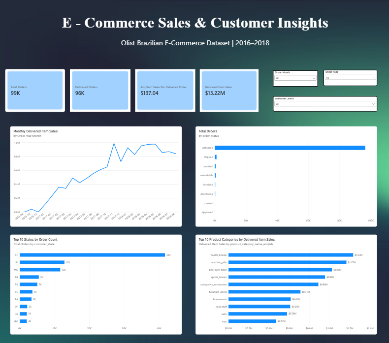

# E-Commerce Sales & Customer Insights Analytics

An end-to-end data analytics project using **Python, Pandas, SQL, DuckDB, Matplotlib, and Power BI**.

## Project Overview

Analyzed 99,441 historical Brazilian e-commerce orders from the Olist dataset to explore sales performance, product demand, customer geography, and delivery efficiency.

Built an interactive Power BI dashboard with KPI cards, sales charts, customer-state comparisons, product-category rankings, and dynamic slicers.

## Tools & Technologies

- **Python:** Data exploration and cleaning
- **Pandas:** Data transformation and merging
- **SQL & DuckDB:** Business queries and revenue calculations
- **Matplotlib:** Data visualization
- **Power BI:** Interactive dashboard development
- **DAX:** Business KPI calculations

## Key Findings

| Metric | Result |
|---|---:|
| Total Orders | 99,441 |
| Delivered Orders | 96,478 |
| Delivered Item Sales | R$13.22 Million |
| Average Item Sales per Delivered Order | R$137.04 |
| Late Delivery Rate | 6.77% |
| Highest Order Volume Month | November 2017 |

São Paulo had the highest order volume among Brazilian states. Health & Beauty, Watches & Gifts, and Bed & Bath were among the leading product categories by delivered-item sales.

## Dashboard Features
## Dashboard Preview


- Total and delivered order KPI cards
- Delivered-item sales and average order value metrics
- Monthly sales trend analysis
- Orders by status
- Top 10 customer states
- Top 10 product categories
- Interactive Year, Month, and State slicers

## Project Structure

```text
Ecommerce_Data_Analytics/
├── scripts/
├── sql/
├── data/
├── dashboards/
├── reports/
└── README.md
```

## Data Source

[Olist Brazilian E-Commerce Public Dataset — Kaggle](https://www.kaggle.com/datasets/olistbr/brazilian-ecommerce)

## Methodology

1. Loaded and explored multiple CSV datasets.
2. Checked missing values and duplicate records.
3. Converted date columns and prepared the data.
4. Performed exploratory data analysis using Pandas.
5. Executed SQL queries to investigate orders and item sales.
6. Built relationships between orders, customers, products, and order items in Power BI.
7. Created DAX measures and interactive dashboard visualizations.
8. Prepared business findings and recommendations.

## Business Recommendations

- Investigate delivery delays by region and seller.
- Evaluate inventory availability in high-demand product categories.
- Examine seasonal sales patterns.
- Use interactive KPIs to monitor fulfillment performance.

## Limitations

The dataset contains historical records from 2016–2018. Item sales values exclude freight and refunds and should not be interpreted as net profit.

## Author

**G. Sanjansah**

B.Tech Student | Aspiring Data Analyst / AI-ML Engineer